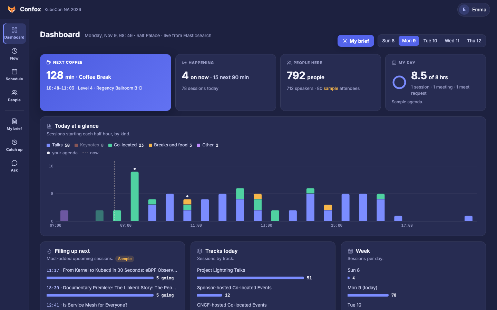
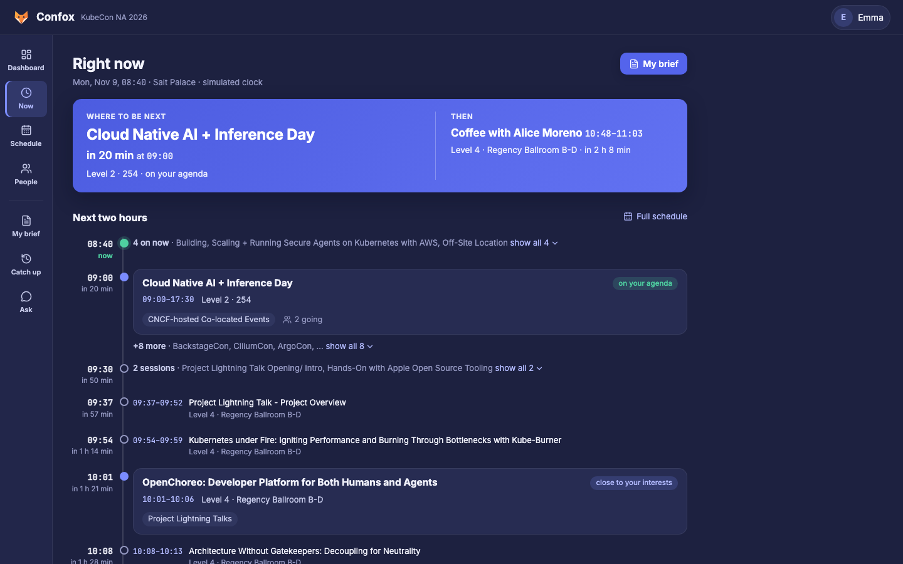
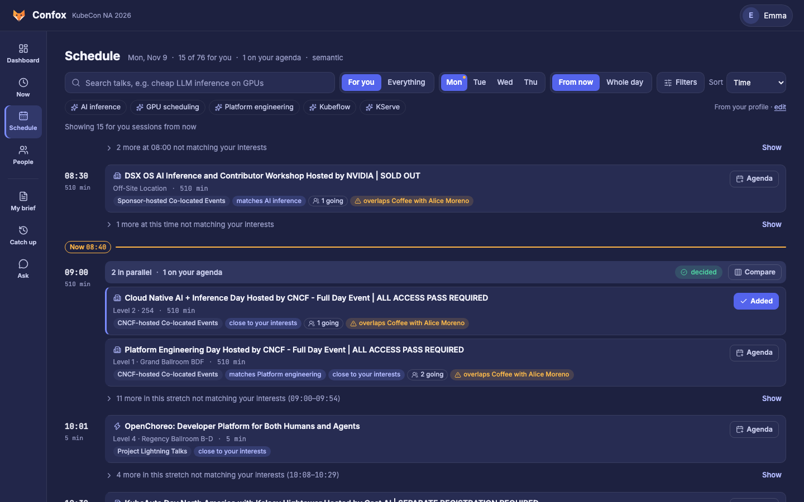
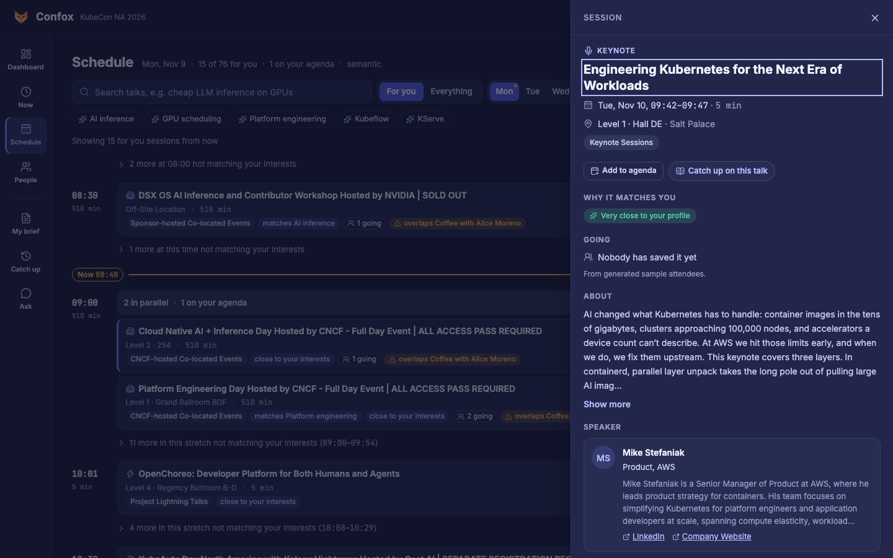
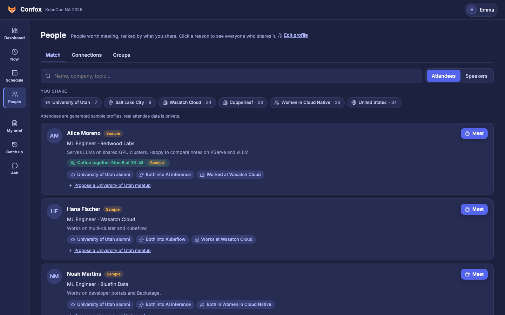
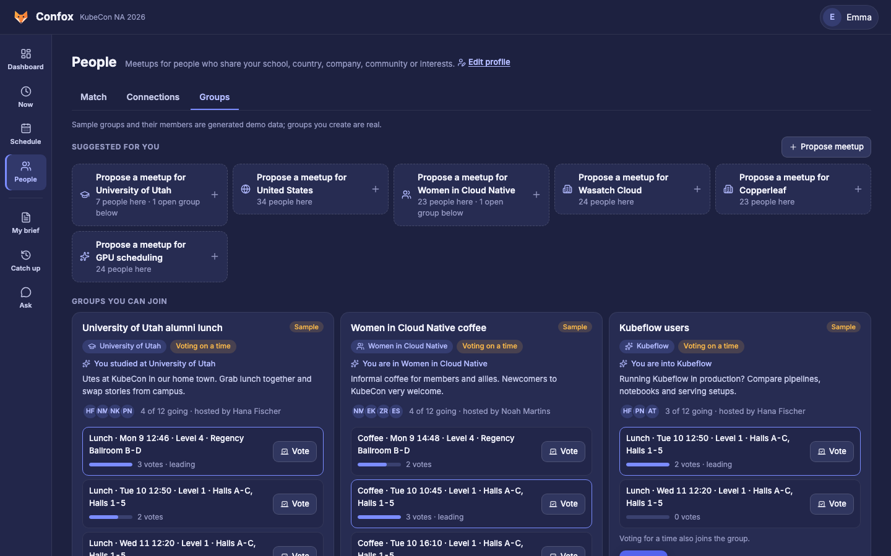
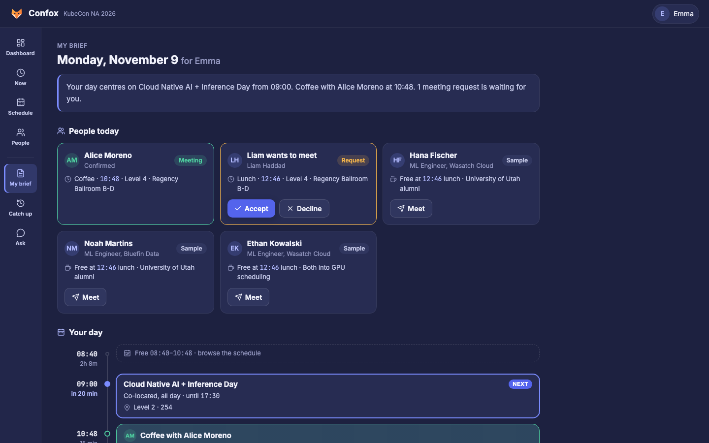
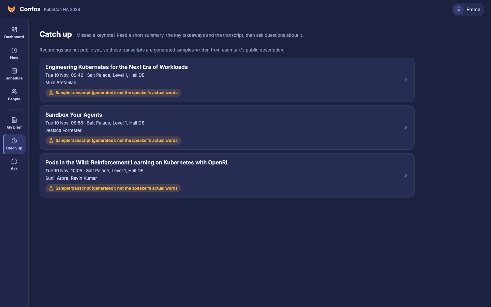
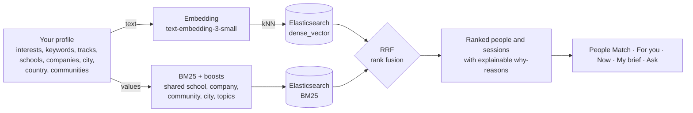
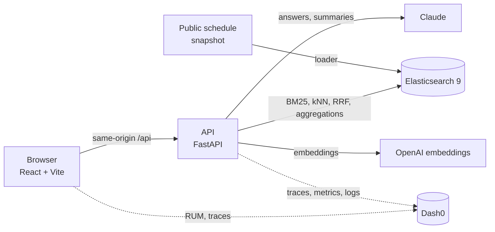

<p align="center">
  
</p>

<h1 align="center">Confox · your KubeCon guide, ranked by your profile</h1>

<p align="center">
  <b>Find the right talk. Meet the right people. Catch up on what you missed.</b><br>
  A conference companion for KubeCon + CloudNativeCon North America 2026 where <b>your profile drives Elasticsearch</b>:
  hybrid search (BM25 + kNN vectors fused with RRF) ranks sessions and people for you, and every match says why.
</p>

<p align="center">
  <a href="#screenshots">Screenshots</a> ·
  <a href="#how-your-profile-drives-elasticsearch">How matching works</a> ·
  <a href="#hackathon-tracks">Tracks</a> ·
  <a href="#run-it-locally">Run it</a> ·
  <a href="#faq">FAQ</a>
</p>

<p align="center">
  <a href="https://www.wemakedevs.org"></a>
  <a href="LICENSE"></a>
  <a href="https://github.com/riponcm/ConFox/pulls?q=is%3Apr"></a>
</p>

<p align="center"><b>Sponsor tools</b></p>
<p align="center">
  <a href="https://www.elastic.co/elasticsearch"></a>
  <a href="https://www.dash0.com"></a>
  <a href="https://gitar.ai"></a>
</p>

<p align="center"><b>Built with</b></p>
<p align="center">
  
  
  
  
  
  
  
  
  
</p>

---

## Why

KubeCon North America has hundreds of sessions across parallel rooms, thousands of people and only a few days. Attendees miss the talk that mattered, never meet the people they came to meet, and lose the sessions that clashed with something else. People who cannot attend every session in person, because of clashes, caregiving, mobility or hearing, lose the most.

Confox turns one thing you already know, **who you are and what you care about**, into a ranked, explained plan for your conference.

## Screenshots

The demo follows **Emma**, a platform engineer and University of Utah alumna, at **08:40 on Monday 9 November** (a fixed demo clock).

| Dashboard | Now |
|---|---|
|  |  |
| **Schedule · For you** | **Session details** |
|  |  |
| **People · Match** | **People · Groups** |
|  |  |
| **My brief** | **Catch up** |
|  |  |

## What Confox does

| Page | What you can do | Under the hood |
|---|---|---|
| **Profile** | Edit interests, keywords, tracks, universities, companies, city, country, communities, what you are looking for, links, visibility | Saving re-embeds your profile; every page re-ranks immediately |
| **Dashboard** | The conference pulse: next coffee, what is on, who is here, how full your day is, sessions through the day by kind, filling up next, tracks, week, activity, countries, top searches, universities, companies, interests | One `msearch` of `size: 0` aggregations over four indices |
| **Now** | Where to be next and what comes after, then the next two hours with one featured session per slot and who is going | Agenda, `next_food()`, for-you scoring, going counts |
| **Schedule** | Search in your own words; **For you** or Everything; filters (kind, track, level, venue, on my agenda, friends going, no clashes); sort by time, best match or most going; interest chips from your profile; **Compare** parallel talks; add to agenda | Hybrid search (BM25 + kNN, RRF), facets from aggregations |
| **Session details** | Click any title: speakers with bios and links, why it matches you, who is going, clashes, **similar sessions**, catch-up link | kNN on the session's own vector |
| **People** | **Match** ranked by what you share, with clickable reasons; **Meet** at a break you are both free; **Connections** (accept, decline, withdraw); **Groups**: propose or join a meetup by university, country, company or community, vote, fix a time; **Hallway board** posts | BM25 + kNN on your profile vector, RRF, explainable boosts |
| **My brief** | Your day in one page: summary, people today, timeline with free gaps, suggestions | Same ranking as People and For you |
| **Catch up** | Missed a keynote? Summary, takeaways, the transcript and Q&A grounded in it | Transcript chunks in Elasticsearch, Claude |
| **Ask** | Ask anything; answers cite real sessions **and people** ("Who should I meet about GPU scheduling?") | Hybrid retrieval over sessions, people and transcripts, then Claude |

## How your profile drives Elasticsearch



1. Your profile becomes **text** (for a vector) and **values** (for exact matching).
2. Elasticsearch runs a **kNN** search on the profile vector and a **BM25** query with a boost for every value you share.
3. The two lists are fused with **reciprocal rank fusion** (the native `rrf` retriever; on a basic licence the same fusion runs client-side).
4. Explainable reasons ("University of Utah alumni", "Both into AI inference", "close to your interests") come from the same overlap, so every match says **why**.
5. Edit your profile and the next request ranks with the new vector: add *eBPF* and *BUET* and People shows BUET alumni and For you gains eBPF talks.

## Hackathon tracks

| Track | Evidence |
|---|---|
| **Elasticsearch** | The only data store (sessions, people, agenda, transcripts, activity, groups). Hybrid search with BM25 + kNN and RRF for sessions, people and Ask; kNN similar sessions; facets, Dashboard and group suggestions are aggregations; native RRF with a client-side fallback. See [Search](docs/architecture.md#search-pull-request-3) and [Profile drives matching](docs/architecture.md). |
| **Dash0** | OpenTelemetry traces, metrics and logs from the API and browser RUM from the web app, joined into one trace per click. Every Claude call is a `chat {model}` span with tokens and cost. Product metrics and a dashboard as code in [dash0/](dash0/README.md). Agent0 diagnosed the errors in a rehearsal and found test runs polluting telemetry, fixed in [#21](https://github.com/riponcm/ConFox/pull/21). |
| **Gitar** | Every change landed as a Gitar-reviewed pull request against [project rules](.gitar/review/confox.md); `main` requires CI and Gitar. Gitar caught a silent dependency downgrade ([#3](https://github.com/riponcm/ConFox/pull/3)), double-booked meetups ([#31](https://github.com/riponcm/ConFox/pull/31)), an unauthenticated profile write ([#32](https://github.com/riponcm/ConFox/pull/32)), and was right to stop a "fix" that would have hidden server errors ([#20](https://github.com/riponcm/ConFox/pull/20), closed). |
| **Merge Forward** | Catch up turns a missed talk into readable text: summary, takeaways and grounded Q&A, for people kept away by clashes, caregiving, mobility or hearing. |

## Architecture



| Index | Holds |
|---|---|
| `confox-sessions` | 600 sessions from the public schedule, with kind, track, room, speakers and a 1536-d vector |
| `confox-people` | 712 public speaker profiles and 80 sample attendees, with vectors |
| `confox-agenda` | Saved sessions, meetings and requests (Emma's demo day and sample attendees' agendas) |
| `confox-transcripts` | Three sample keynote transcripts in chunks, plus cached summaries |
| `confox-activity` | One small event per search, match, agenda change, request and question, for the Dashboard |
| `confox-groups` | Meetup groups (members, proposed times, votes, fixed time) and hallway board posts |

Design decisions and conventions: [docs/architecture.md](docs/architecture.md).

## Run it locally

Needs Docker, [uv](https://docs.astral.sh/uv/) and Node 22+.

```bash
cp .env.example .env
```

Everything runs without keys (keyword-only, no Ask). `OPENAI_API_KEY` adds embeddings and hybrid search, `ANTHROPIC_API_KEY` adds Ask and Catch up, and the `OTEL_*` / `VITE_DASH0_*` values send telemetry to Dash0 (the browser token must be ingest-only).

```bash
docker compose up -d
```

```bash
cd backend && uv sync && uv run python -m app.load && uv run python -m app.data.transcripts --load
```

```bash
cd backend && uv run uvicorn app.main:app --port 8000
```

```bash
cd frontend && npm install && npm run dev
```

Open http://localhost:5173. The Dash0 dashboard imports from [dash0/confox-dashboard.json](dash0/README.md).

Checks, as CI runs them:

```bash
cd backend && uv run ruff check . && uv run ruff format --check . && uv run pytest -q
```

```bash
cd frontend && npm run lint && npm run build
```

## Demo in five minutes

1. **Dashboard**: the conference pulse, all Elasticsearch aggregations.
2. **Edit profile**: add an interest and a university, save; People and For you re-rank.
3. **Schedule**: search "running LLM inference cheaply on GPUs" (hybrid ranks the cost talks first); open a session; Compare the 09:00 slot.
4. **People**: Alice first ("University of Utah alumni"); Meet at a free break; propose a University of Utah meetup.
5. **Ask**: "Who should I meet about GPU scheduling?" cites people and sessions, with tokens and cost.
6. **Catch up**: a keynote summary and a question.
7. **Dash0** and **GitHub**: the trace of that question with cost, Agent0's diagnosis, and the Gitar-reviewed pull requests.

## How we built it

The code in this repository was written during the hackathon, one feature per branch and pull request; the [pull request list](https://github.com/riponcm/ConFox/pulls?q=is%3Apr) is the build log. Research and notes gathered before the event are in [docs/research.md](docs/research.md).

| Doc | What it covers |
|---|---|
| [Idea](docs/idea.md) | Problem, persona, features, what is out of scope |
| [Plan](docs/plan.md) | Build order, lanes, cut line |
| [Architecture](docs/architecture.md) | Components, data, each feature's design, key decisions |
| [Research](docs/research.md) | Notes gathered before the event |
| [Team tasks](docs/tasks/README.md) | Self-contained briefs for team members |
| [Data](data/README.md) | What we collected, when, from where, and what is generated |

## Team

<table>
  <tr>
    <td align="center"><a href="https://github.com/riponcm"><br><b>riponcm</b></a><br><sub>Lead: architecture, backend, integration, reviews</sub></td>
    <td align="center"><a href="https://github.com/FIZ55"><br><b>FIZ55</b></a><br><sub>SessionCard component (<a href="https://github.com/riponcm/ConFox/pull/8">#8</a>), used on Schedule, Now and My brief</sub></td>
    <td align="center"><a href="https://github.com/yuzimeng2000-coder"><br><b>yuzimeng2000-coder</b></a><br><sub><code>next_food()</code> for Now and the Dashboard (<a href="https://github.com/riponcm/ConFox/pull/17">#17</a>)</sub></td>
  </tr>
</table>

## AI use

Hackathon rule 5 asks us to disclose AI use. Here is all of it:

- **Coding assistants.** Much of the code was written with [Claude Code](https://claude.com/claude-code) (Anthropic), including several features built in parallel by Claude Code agents (Claude Opus and Sonnet) from written briefs, each in its own branch; their pull requests say so. yuzimeng2000-coder used OpenAI Codex for #17 and disclosed it in the pull request. The team chose the design, wrote the briefs and review rules, reviewed and tested every change, and can explain every part of the code.
- **Code review.** Every pull request was reviewed by Gitar; its findings and our fixes are in the pull request threads.
- **In the app.** Ask and Catch up call Claude (`claude-opus-5-5`) and show token use and cost. Search and matching use OpenAI `text-embedding-3-small` vectors.
- **Generated data, always labelled.** The 80 attendee profiles, their agendas, groups, board posts, activity events and Emma's agenda are generated by seeded code (marked `sample`). The three keynote transcripts were generated by Claude from each talk's public title and description and are labelled in the app as *not the speaker's actual words*. Real attendee data and recordings are not public. See [data/README.md](data/README.md).

## FAQ

**Is the data real?**
The schedule (600 sessions) and the 712 speaker profiles are the public KubeCon NA 2026 schedule on Sessionize. Attendees, their agendas, groups, board posts, activity and keynote transcripts are generated sample data, labelled as such in the app, because real attendee data and recordings are private.

**How does Confox decide who I should meet and which talks are for me?**
Your profile becomes a vector and a set of values. Elasticsearch runs a kNN search on the vector and a BM25 query with boosts for shared values, fuses the two lists with reciprocal rank fusion (RRF), and returns the reasons for each match. See [How your profile drives Elasticsearch](#how-your-profile-drives-elasticsearch).

**What happens when I edit my profile?**
The profile is saved to Elasticsearch, its embedding is recomputed if the text changed, and People, Schedule For you, Now, the Dashboard and My brief re-rank on the next request.

**Do I need paid licences or API keys?**
No paid licence: Compose starts Elasticsearch with a trial licence, and without it RRF runs client-side. Without an OpenAI key search and matching fall back to keywords; without an Anthropic key Ask and Catch up are off.

**Which Elasticsearch features does it use?**
BM25 `multi_match`, `dense_vector` kNN, the `rrf` retriever, `msearch`, terms, filters, cardinality, date_histogram and top_hits aggregations, post filters, and explicit mappings per index.

**What does Dash0 see?**
Traces, metrics and logs from the API (every request, every Elasticsearch call, every Claude call with tokens and cost) and browser RUM from the web app. API keys and tokens are never sent, and the only attendee data in the demo is generated sample data.

**Are the keynote transcripts what the speakers said?**
No. They are samples generated from each talk's public title and description and labelled "not the speaker's actual words" wherever they appear.

**Can it work for other conferences?**
Yes. Point the loader at another Sessionize feed (or any schedule with sessions, speakers and rooms) and the same indices, ranking and pages apply.

**How do I reset the demo?**
`uv run python -m app.load --only agenda --only activity --only groups` restores Emma's day, the sample agendas, activity and groups.

**What did the team do and what did AI do?**
The team designed the product and data model, wrote the briefs and review rules, reviewed and tested every pull request and integrated the features; AI assistants wrote much of the code under that direction. See [AI use](#ai-use).

## Credits

- Schedule data: the public KubeCon + CloudNativeCon North America 2026 schedule on Sessionize ([provenance](data/README.md)).
- Sponsor tools: [Elasticsearch](https://www.elastic.co/elasticsearch), [Dash0](https://www.dash0.com), [Gitar](https://gitar.ai).
- Built at the [WeMakeDevs](https://www.wemakedevs.org) Cloud Native Hackathon, Salt Lake City, November 2026.

## License

[Apache License 2.0](LICENSE)

<sub>Keywords: KubeCon, CloudNativeCon, conference app, Elasticsearch, hybrid search, BM25, kNN, vector search, semantic search, reciprocal rank fusion, RRF, aggregations, RAG, Claude, OpenAI embeddings, OpenTelemetry, Dash0, Gitar, FastAPI, React, TypeScript, networking, meetups, accessibility, WeMakeDevs hackathon.</sub>
