<p align="center">
  
</p>

<p align="center">
  <a href="https://www.wemakedevs.org"></a>
  <a href="LICENSE"></a>
  
</p>

<p align="center"><b>Sponsor tools</b></p>
<p align="center">
  <a href="https://www.elastic.co/elasticsearch"></a>
  <a href="https://www.dash0.com"></a>
  <a href="https://gitar.ai"></a>
</p>

<p align="center"><b>Built with</b></p>
<p align="center">
  
  
  
  
  
  
  
  
</p>

---

## Why

KubeCon North America has hundreds of sessions across parallel rooms, thousands of people and only a few days. Attendees miss the talk that mattered, never meet the people they came to meet, and lose the sessions that clashed with something else. People who cannot attend every session in person — because of clashes, caregiving, mobility or hearing — lose the most.

## What Confox does

| | Feature | In one line |
|---|---|---|
| 1 | **Search** | Ask for a talk in your own words; keyword and meaning-based search together. |
| 2 | **Schedule · For you** | Your day, filtered to what fits your profile; everything else folds away. |
| 3 | **People · Match** | People who share your interests, school, company or community, with the reason shown. |
| 4 | **Ask** | Questions about the conference answered with citations to real sessions. |
| 5 | **Catch up** | Summaries, takeaways and Q&A for talks you missed. |
| 6 | **Dashboard · Now** | The conference pulse: what is on now, next, and where the coffee is. |

Feature details and user stories: [docs/idea.md](docs/idea.md).

## Hackathon tracks

| Track | How Confox addresses it |
|---|---|
| Elasticsearch | Elasticsearch is the only data store; hybrid search, aggregations for filters and the dashboard. |
| Dash0 | OpenTelemetry traces, metrics, logs and browser RUM from day one; a product dashboard. |
| Gitar | Every feature lands as a Gitar-reviewed pull request with project-specific review rules. |
| Merge Forward | Catch up makes missed sessions accessible. |

## How it is built

Implementation is described in the docs as each piece lands; every feature is a separate pull request, so the pull request list is the build log.

| Doc | What it covers |
|---|---|
| [Idea](docs/idea.md) | Problem, persona, features, what is out of scope |
| [Plan](docs/plan.md) | Build order, one pull request per feature, cut line |
| [Architecture](docs/architecture.md) | Components and data flow (filled in as we build) |
| [Research](docs/research.md) | Notes gathered before the event: data, search, observability |
| [Data](data/README.md) | What we collected, when, from where, and what is generated |

## Run locally

Needs Docker, [uv](https://docs.astral.sh/uv/) and Node 22+.

```bash
cp .env.example .env    # fill in keys; .env is git-ignored
docker compose up -d    # Elasticsearch on localhost:9200
```

```bash
cd backend && uv sync && uv run uvicorn app.main:app --port 8000 --reload
```

```bash
cd frontend && npm install && npm run dev
```

Open http://localhost:5173 — the page shows whether the API and Elasticsearch are up.
How we work (branches, checks, review): [CONTRIBUTING.md](CONTRIBUTING.md).

## Team

<table>
  <tr>
    <td align="center"><a href="https://github.com/riponcm"><br><b>riponcm</b></a></td>
    <td align="center"><a href="https://github.com/FIZ55"><br><b>FIZ55</b></a></td>
    <td align="center"><a href="https://github.com/yuzimeng2000-coder"><br><b>yuzimeng2000-coder</b></a></td>
  </tr>
</table>

Who built what is visible in the pull requests and commit history.

## AI use

We use [Claude Code](https://claude.com/claude-code) (Anthropic) as a coding assistant. The team decides the design, reviews and tests every change, and can explain every part of the code. Pull requests are also reviewed by Gitar. Any generated sample data in the app is labelled as such.

## Credits

- Schedule data: the public KubeCon + CloudNativeCon North America 2026 schedule on Sessionize ([provenance](data/README.md)).
- Sponsor tools: Elasticsearch, Dash0, Gitar.
- Built at the [WeMakeDevs](https://www.wemakedevs.org) Cloud Native Hackathon, Salt Lake City, November 2026.

## License

[Apache License 2.0](LICENSE)
