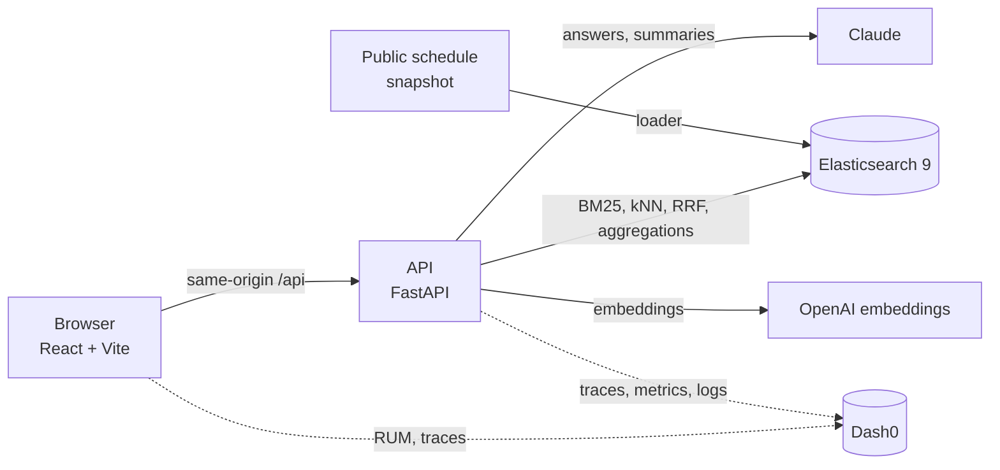

<p align="center">
  
</p>

<p align="center">
  <a href="https://www.wemakedevs.org"></a>
  <a href="LICENSE"></a>
  <a href="https://github.com/riponcm/ConFox/pulls?q=is%3Apr"></a>
</p>

<p align="center"><b>Sponsor tools</b></p>
<p align="center">
  <a href="https://www.elastic.co/elasticsearch"></a>
  <a href="https://www.dash0.com"></a>
  <a href="https://gitar.ai"></a>
</p>

<p align="center"><b>Built with</b></p>
<p align="center">
  
  
  
  
  
  
  
  
  
</p>

---

## Why

KubeCon North America has hundreds of sessions across parallel rooms, thousands of people and only a few days. Attendees miss the talk that mattered, never meet the people they came to meet, and lose the sessions that clashed with something else. People who cannot attend every session in person, because of clashes, caregiving, mobility or hearing, lose the most.

## What Confox does

The demo follows **Emma**, a platform engineer and University of Utah alumna, at **08:40 on Monday 9 November** (a fixed demo clock, `DEMO_NOW`).

| Page | What it does | Built on |
|---|---|---|
| **Dashboard** | The conference pulse: sessions through the day with a now line, starting soon, top tracks, where attendees come from | Elasticsearch aggregations only |
| **Now** | Next coffee or food ("Coffee Break in 2 h 8 min"), your next agenda item, what is on now and starting soon | `next_food()`, the clock, the agenda index |
| **Schedule** | Day view filtered **For you** (agenda, keynotes, food, interest matches, nearest sessions by meaning); everything else folds away. Search box with hybrid search | BM25 + kNN, fused with RRF |
| **People** | **Match**: people ranked by shared school, company, community, city and interests, each with the reason shown; click a reason to filter by it | Boosted query + vector similarity |
| **Ask** | Questions about the conference answered by Claude with numbered citations to real sessions, streamed, with tokens and cost shown | Retrieval from Elasticsearch, then Claude |
| **Catch up** | Missed a keynote? TL;DR, three takeaways, the transcript and Q&A grounded in it | Transcript chunks in Elasticsearch, Claude |

Feature details and user stories: [docs/idea.md](docs/idea.md).

## Hackathon tracks

| Track | Where to look |
|---|---|
| **Elasticsearch** | Elasticsearch is the only data store (sessions, people, agenda, transcripts). Hybrid search: BM25 and kNN on OpenAI embeddings fused with the native RRF retriever, with a client-side RRF fallback on a basic licence. Facets, the Dashboard and the For-you list are aggregations and filtered queries. See [Search](docs/architecture.md#search-pull-request-3). |
| **Dash0** | OpenTelemetry from the first hour: traces, metrics and logs from the API, browser RUM from the web app, joined into one trace per click. Every Claude call is a `chat {model}` span with GenAI attributes, tokens and cost. Product metrics (searches by mode, matches, chat turns, Claude cost) and a dashboard as code in [dash0/](dash0/README.md). A demo-only endpoint triggers a real Elasticsearch error for Agent0 to find. |
| **Gitar** | Every change landed as a pull request reviewed by Gitar against project rules in [.gitar/review/confox.md](.gitar/review/confox.md). Its findings were fixed in the same pull request and answered in the thread (for example a silent dependency downgrade, a 30 s health-check timeout, a weekday bug in Ask). `main` requires CI and Gitar to pass. |
| **Merge Forward** | Catch up turns a missed talk into readable text: summary, takeaways and grounded Q&A, for people kept away by clashes, caregiving, mobility or hearing. |

## Architecture



| Index | Holds |
|---|---|
| `confox-sessions` | 600 sessions from the public schedule, with kind, track, room, speakers and a 1536-d vector |
| `confox-people` | 712 public speaker profiles and 80 sample attendees, with vectors |
| `confox-agenda` | Emma's Monday (sample) |
| `confox-transcripts` | Three sample keynote transcripts in chunks, plus cached summaries |

Design decisions and the conventions every feature follows: [docs/architecture.md](docs/architecture.md).

## Run locally

Needs Docker, [uv](https://docs.astral.sh/uv/) and Node 22+.

```bash
cp .env.example .env
```

Fill in `.env` (it is git-ignored). Everything runs without keys, keyword-only and without Ask; `OPENAI_API_KEY` adds embeddings and hybrid search, `ANTHROPIC_API_KEY` adds Ask and Catch up, and the `OTEL_*` and `VITE_DASH0_*` values send telemetry to Dash0 (the browser token must be ingest-only).

```bash
docker compose up -d
```

```bash
cd backend && uv sync && uv run python -m app.load && uv run python -m app.data.transcripts --load
```

```bash
cd backend && uv run uvicorn app.main:app --port 8000
```

```bash
cd frontend && npm install && npm run dev
```

Open http://localhost:5173. The loader prints the counts (600 sessions, 792 people). The Dash0 dashboard imports from [dash0/confox-dashboard.json](dash0/README.md).

Checks, as CI runs them:

```bash
cd backend && uv run ruff check . && uv run ruff format --check . && uv run pytest -q
```

```bash
cd frontend && npm run lint && npm run build
```

## How we built it

The code in this repository was written during the hackathon, one feature per branch and pull request; the [pull request list](https://github.com/riponcm/ConFox/pulls?q=is%3Apr) is the build log. Research and notes gathered before the event are in [docs/research.md](docs/research.md).

| Doc | What it covers |
|---|---|
| [Idea](docs/idea.md) | Problem, persona, features, what is out of scope |
| [Plan](docs/plan.md) | Build order, lanes, cut line, demo script |
| [Architecture](docs/architecture.md) | Components, data, each feature's design, key decisions |
| [Research](docs/research.md) | Notes gathered before the event |
| [Team tasks](docs/tasks/README.md) | Self-contained briefs for team members |
| [Data](data/README.md) | What we collected, when, from where, and what is generated |

## Team

<table>
  <tr>
    <td align="center"><a href="https://github.com/riponcm"><br><b>riponcm</b></a><br><sub>Lead: architecture, backend, integration, reviews</sub></td>
    <td align="center"><a href="https://github.com/FIZ55"><br><b>FIZ55</b></a><br><sub>SessionCard component (<a href="https://github.com/riponcm/ConFox/pull/8">#8</a>), used on Schedule and Now</sub></td>
    <td align="center"><a href="https://github.com/yuzimeng2000-coder"><br><b>yuzimeng2000-coder</b></a><br><sub><code>next_food()</code> for the Now page (<a href="https://github.com/riponcm/ConFox/pull/17">#17</a>)</sub></td>
  </tr>
</table>

## AI use

Hackathon rule 5 asks us to disclose AI use. Here is all of it:

- **Coding assistants.** Much of the code was written with [Claude Code](https://claude.com/claude-code) (Anthropic). Several features were built in parallel by Claude Code agents from written briefs, each in its own branch; their pull requests say so. yuzimeng2000-coder used OpenAI Codex for #17 and disclosed it in the pull request. The team chose the design, wrote the briefs and review rules, reviewed and tested every change, and can explain every part of the code.
- **Code review.** Every pull request was reviewed by Gitar; its findings and our fixes are in the pull request threads.
- **In the app.** Ask and Catch up call Claude (`claude-opus-5-5`) and show token use and cost. Search and matching use OpenAI `text-embedding-3-small` vectors.
- **Generated data, always labelled.** The 80 attendee profiles and Emma's agenda are generated by seeded code (marked `sample`). The three keynote transcripts were generated by Claude from each talk's public title and description and are labelled in the app as *not the speaker's actual words*. Real attendee data and recordings are not public. See [data/README.md](data/README.md).

## Credits

- Schedule data: the public KubeCon + CloudNativeCon North America 2026 schedule on Sessionize ([provenance](data/README.md)).
- Sponsor tools: [Elasticsearch](https://www.elastic.co/elasticsearch), [Dash0](https://www.dash0.com), [Gitar](https://gitar.ai).
- Built at the [WeMakeDevs](https://www.wemakedevs.org) Cloud Native Hackathon, Salt Lake City, November 2026.

## License

[Apache License 2.0](LICENSE)
