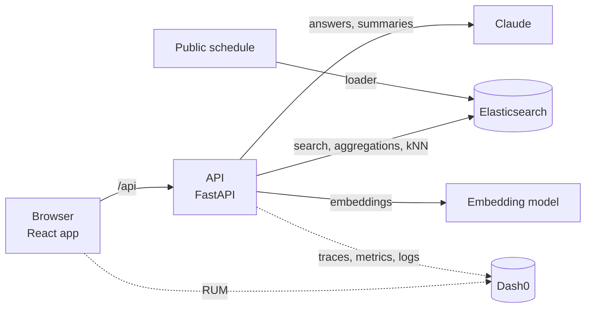
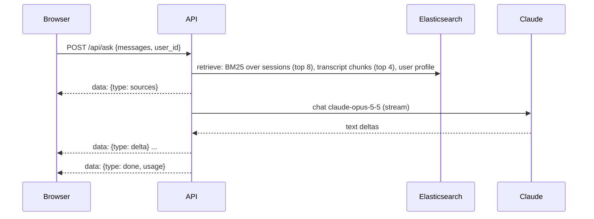

# Architecture

Concept only for now. Each section is filled in by the pull request that builds it.

## Components

| Component | Role | Detailed in |
|---|---|---|
| Browser app | Pages, navigation, browser telemetry | Pull request 2b |
| API | One service; every endpoint traced | Pull requests 0, 1 |
| Elasticsearch | Sessions, people, agendas, transcripts, connections | Pull requests 2, 3 |
| LLM | Ask and Catch up answers, grounded in retrieved documents | Pull requests 8, 9 |
| Telemetry | OpenTelemetry to Dash0: traces, metrics, logs, RUM | Pull requests 1, 12 |

## Data (pull request 2)

`uv run python -m app.load` reads the snapshot in `data/raw/` and fills three indices. `--only sessions|people|agenda` rebuilds one index and leaves the others alone.

| Index | Holds | Count |
|---|---|---|
| `confox-sessions` | Every scheduled session: time (local, no offset), day, room, venue, track, level, CNCF projects, speakers, kind, `is_food` | 600 |
| `confox-people` | 712 public speaker profiles from the schedule, plus 80 generated attendees marked `sample: true` (Emma and Alice first, then University of Utah alumni) | 792 |
| `confox-agenda` | Emma's Monday: the co-located AI day, a confirmed coffee with Alice, a pending lunch request (all `sample: true`) | 3 |

Session kinds come from the track and the cleaned title: `keynote`, `talk`, `lightning`, `tutorial`, `contribfest`, `poster`, `showcase`, `colocated`, `break`, `registration`. Titles are stripped of emoji first, so "☕ Coffee Break" inside the Project Lightning Talks track is a `break` with `is_food`.

Planned: vectors on sessions and people (pull request 3), connections (pull request 7). Transcripts: see Catch up (pull request 9).

## Telemetry (pull request 1)

| Signal | Source | Where it goes |
|---|---|---|
| Traces | FastAPI instrumentation for every request; the Elasticsearch 9 client traces its own calls as child spans | Dash0 via OTLP/HTTP |
| Logs | Python logging, exported with the active trace and span IDs | Dash0 via OTLP/HTTP |
| Metrics | HTTP server metrics from the instrumentation; product metrics added with each feature | Dash0 via OTLP/HTTP |
| Browser | Dash0 web SDK: page views, web vitals, fetch calls, errors; adds the trace header to same-origin `/api` calls | Dash0, ingest-only token |

Export switches on only when `OTEL_EXPORTER_OTLP_ENDPOINT` is set. A demo-only endpoint (`POST /api/debug/break`, off by default) sends Elasticsearch a query it rejects, so Dash0 has a real error to find.

## How features plug in

| Piece | Where | Rule |
|---|---|---|
| API routes | `backend/app/routers/<feature>.py` defining `router = APIRouter(prefix="/api/<feature>")` | Discovered automatically; never edit `main.py` to add a feature |
| Current time | `app.clock.now()` | Demo moment (`DEMO_NOW`, Monday 8:40) or real Salt Lake City time; naive, like the schedule |
| Signed-in user | `settings.demo_user` / `GET /api/meta` | `emma` in the demo |
| Frontend calls | `getJSON` / `postJSON` from `src/api.ts` | Same-origin `/api`, so browser and API spans join one trace |
| Feature UI | `src/pages/<Page>.tsx` plus `src/components/<feature>/` and `src/styles/<feature>.css` | Keeps parallel features out of each other's files |

## Ask (pull request 8)

`POST /api/ask` answers a question from retrieved sessions and streams the answer as Server-Sent Events.

| Piece | Where | Notes |
|---|---|---|
| Retrieval | `routers/ask.py`, span `retrieve` | `multi_match` over title^3, speaker_names^2, projects^2, track, description; breaks and registration excluded. A day named in the question ("today", "tomorrow", "Wednesday") filters to that day; otherwise today gets a small boost |
| Prompt | system: role, `clock.now()` spoken ("Monday 9 November, 08:40"), the user's interests and school; latest user turn: numbered sources then the question | Earlier turns are sent back as plain text |
| Answer | Claude cites `[n]`; the browser shows chips only for the sources the answer cites, with day, time and room | Says so when the sources do not answer |
| Events | `sources`, `delta`, `done` (tokens, cost, duration, stop reason) or `error` | Counter `confox.chat.requests` (attribute `feature`) |

### LLM calls (`app/llm.py`)

Every Claude call goes through `llm.complete` (blocking, streamed under the hood) or `llm.stream` (async generator for Server-Sent Events). Model from `settings.llm_model` (`claude-opus-5-5`), official `anthropic` Python SDK, effort `low`, server-side refusal fallback (`fallbacks: "default"`).

| Signal | Name | Content |
|---|---|---|
| Span | `chat {model}` (kind client) | `gen_ai.operation.name`, `gen_ai.provider.name` = anthropic, `gen_ai.request.model`, `gen_ai.request.max_tokens`, `gen_ai.response.model`, `gen_ai.response.id`, `gen_ai.response.finish_reasons`, `gen_ai.usage.input_tokens`, `gen_ai.usage.output_tokens`, cache token counts when present, `confox.llm.cost_usd`, `confox.llm.feature` |
| Child span | `anthropic.messages.create` | Emitted by the Anthropic SDK itself (metadata only, no prompt content) |
| Counter | `confox.llm.tokens` | Attributes `type` (input, output, cache_read, cache_write), `model`, `feature` |
| Counter | `confox.llm.cost_usd` | Estimated from the price table in `llm.py` (Opus 5.5: $4 input, $20 output per million tokens) |
| Histogram | `confox.llm.duration` | Milliseconds, per `model` and `feature` |

Streaming calls record usage from the final message when the stream ends. Failures are recorded on the span and logged; the browser receives an `error` event.

## Catch up (pull request 9)

Catch up turns a missed keynote into something readable: a TL;DR, three takeaways, the transcript, and questions answered from that transcript only.

| Piece | Where | Notes |
|---|---|---|
| Sample transcripts | `data/sample/transcripts.json`, written once by `uv run python -m app.data.transcripts --generate` | Three Tuesday 10 November keynotes, about 1300 words each, written by Claude from each keynote's public title, speakers and description only; `sample: true` |
| Index | `confox-transcripts`, loaded by `uv run python -m app.data.transcripts --load` | ~200-word chunks (`doc_type: chunk`, `session_id`, `chunk`, `text`, `sample`); rebuilding it touches no other index and never calls Claude |
| `GET /api/catchup` | `routers/catchup.py` | Talks that have a transcript, with time, room and speakers |
| `GET /api/catchup/{id}` | | Transcript parts and `{tldr, takeaways}`. The summary is generated with Claude (structured JSON output) on the first request and stored in the same index as `summary-{id}` (`doc_type: summary`), so later requests are instant |
| `POST /api/catchup/{id}/ask` | | Server-Sent Events like Ask; every part of that one transcript goes in the prompt and the answer cites part numbers. The browser's chips open the transcript at the cited part |

The UI labels every transcript "Sample transcript (generated)"; on a talk page the label stays pinned while reading. Reading comfort is the point of the feature: larger type, 1.6 to 1.75 line height, lines capped near 65 characters, the transcript collapsed until wanted.

## Key decisions

| Decision | Why |
|---|---|
| Claude answers stream as Server-Sent Events over a POST | The browser reads the same-origin `fetch` body, so the trace header still joins browser and API spans; `EventSource` cannot send a body |
| Sample transcripts generated once and committed | Loading is free and repeatable; nobody pays for or waits on Claude at load time |
| Load `.env` into the process environment at startup | The OTLP exporters read `OTEL_*` from the environment, not from app settings |
| No separate Elasticsearch instrumentor | The Elasticsearch 9 Python client has native OpenTelemetry support; the contrib instrumentor disables itself |
| One `.env` at the repo root for both halves | Only `VITE_*` values reach the browser bundle; everything else stays server side |
| Explicit mappings, one index rebuilt at a time | Dates and keywords behave predictably in filters and aggregations; reloading sessions never wipes people or agendas |
| Times stored as local conference time | The source has no offset and every attendee reads the schedule in Salt Lake City time |
| ASGI `send`/`receive` spans excluded | One server span per request keeps traces readable; Elasticsearch calls still appear as child spans |
