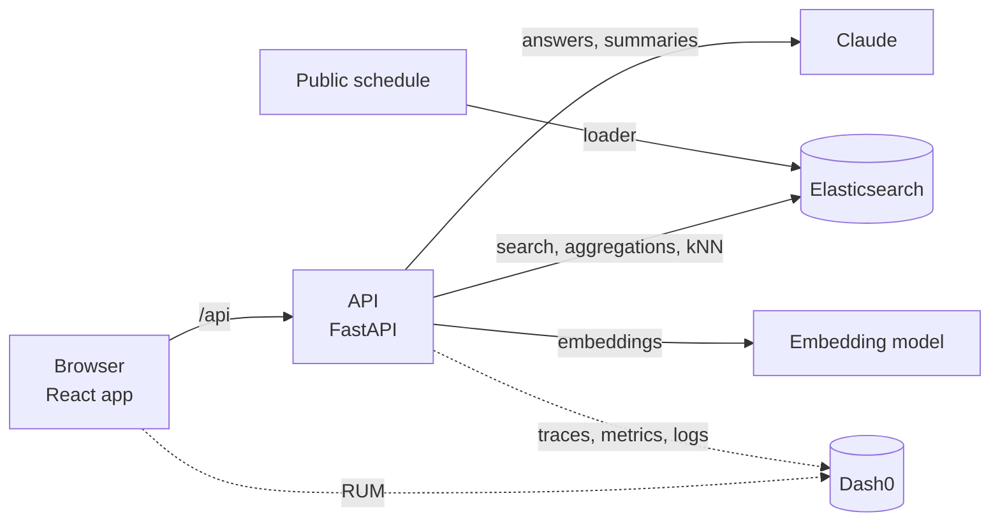

# Architecture

Concept only for now. Each section is filled in by the pull request that builds it.

## Components

| Component | Role | Detailed in |
|---|---|---|
| Browser app | Pages, navigation, browser telemetry | Pull request 2b |
| API | One service; every endpoint traced | Pull requests 0, 1 |
| Elasticsearch | Sessions, people, agendas, transcripts, connections | Pull requests 2, 3 |
| LLM | Ask and Catch up answers, grounded in retrieved documents | Pull requests 8, 9 |
| Telemetry | OpenTelemetry to Dash0: traces, metrics, logs, RUM | Pull requests 1, 12 |

## Data (concept)

| Index | Holds |
|---|---|
| sessions | Talks with time, room, track, kind and a meaning vector |
| people | Profiles: interests, background, a meaning vector |
| agenda | Who plans to attend what |
| transcripts | Talk text in chunks, with vectors, for Catch up and Ask |
| connections | Meeting requests and accepted slots |

## Key decisions

To be recorded here as they are made, with the reason for each.
