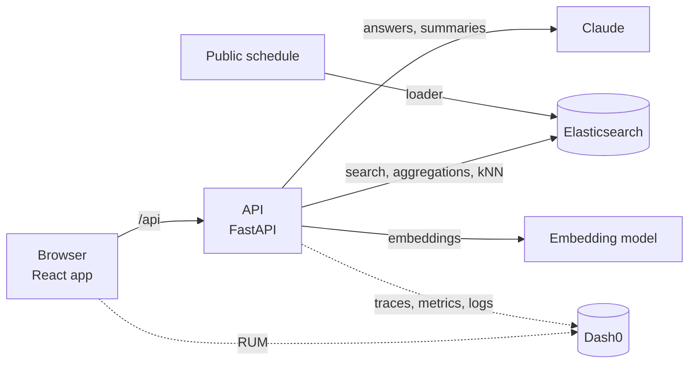

# Architecture

Concept only for now. Each section is filled in by the pull request that builds it.

## Components

| Component | Role | Detailed in |
|---|---|---|
| Browser app | Pages, navigation, browser telemetry | Pull request 2b |
| API | One service; every endpoint traced | Pull requests 0, 1 |
| Elasticsearch | Sessions, people, agendas, transcripts, connections | Pull requests 2, 3 |
| LLM | Ask and Catch up answers, grounded in retrieved documents | Pull requests 8, 9 |
| Telemetry | OpenTelemetry to Dash0: traces, metrics, logs, RUM | Pull requests 1, 12 |

## Data (pull request 2)

`uv run python -m app.load` reads the snapshot in `data/raw/` and fills three indices. `--only sessions|people|agenda` rebuilds one index and leaves the others alone.

| Index | Holds | Count |
|---|---|---|
| `confox-sessions` | Every scheduled session: time (local, no offset), day, room, venue, track, level, CNCF projects, speakers, kind, `is_food` | 600 |
| `confox-people` | 712 public speaker profiles from the schedule, plus 80 generated attendees marked `sample: true` (Emma and Alice first, then University of Utah alumni) | 792 |
| `confox-agenda` | Emma's Monday: the co-located AI day, a confirmed coffee with Alice, a pending lunch request (all `sample: true`) | 3 |

Session kinds come from the track and the cleaned title: `keynote`, `talk`, `lightning`, `tutorial`, `contribfest`, `poster`, `showcase`, `colocated`, `break`, `registration`. Titles are stripped of emoji first, so "☕ Coffee Break" inside the Project Lightning Talks track is a `break` with `is_food`.

Planned: vectors on sessions and people (pull request 3), transcripts (pull request 9), connections (pull request 7).

## People and Match (pull request 6)

`GET /api/people/match` ranks everyone else for the signed-in user (`settings.demo_user`); `GET /api/people/{id}` returns one profile. Both live in `backend/app/routers/people.py`; the page is `src/pages/People.tsx` with `src/components/people/`.

| Shared with the user | Boost | Reason shown |
|---|---|---|
| School | 6 per school | "University of Utah alumni" |
| Current or past company (any overlap) | 3 | "Works at ..." / "Worked at ..." |
| Community | 2 each | "Both in ..." |
| City | 2 | "Also in ..." |
| Interest | 1.5 each | "Both into ..." |
| User's interests as text in a speaker's tracks or bio | BM25 x 0.5 | "Speaks on ..." / "Mentions ..." |

- **One query.** A `bool` of `constant_score` clauses, one per shared value, so each overlap adds a fixed, explainable amount; `minimum_should_match: 0` keeps people with nothing in common at the bottom rather than hiding them. A keyword `q` becomes a `multi_match` must clause on name, title, company, interests and bio. `kind` (Attendees or Speakers tab) is a query filter.
- **Vectors when present.** If the user's profile has an `embedding`, the query is wrapped in `script_score` adding `4 x max(0, cosine)`. A weighted sum, not RRF: the boosts stay in charge (one shared school outweighs any embedding), scores stay readable, and aggregations and `post_filter` keep working on one plain query. If vector scoring fails (field missing mid-rebuild) the request logs a warning, records it on the span and ranks lexically; `semantic` in the response says which happened.
- **Reasons in Python.** `why` is computed from the same overlap the query boosts, at most three, schools first, so every reason is true and clickable. Each reason names its field; clicking it applies that exact filter (`school`, `company`, `community`, `city`, `interest`) or, for a bio mention, a keyword search.
- **Group chips.** `filters` aggregations restricted to the user's own schools, companies, communities, city and country count the other people sharing each. Background filters go in `post_filter`, so chip counts stay stable while chips are toggled.
- **Telemetry.** Requests count on `confox.match.requests` (attributes `kind`, `has_query`, `filtered`); the request span carries `confox.match.semantic`.
- Attendees are generated samples and every card says "Sample"; speakers are public schedule profiles.

## Telemetry (pull request 1)

| Signal | Source | Where it goes |
|---|---|---|
| Traces | FastAPI instrumentation for every request; the Elasticsearch 9 client traces its own calls as child spans | Dash0 via OTLP/HTTP |
| Logs | Python logging, exported with the active trace and span IDs | Dash0 via OTLP/HTTP |
| Metrics | HTTP server metrics from the instrumentation; product metrics added with each feature | Dash0 via OTLP/HTTP |
| Browser | Dash0 web SDK: page views, web vitals, fetch calls, errors; adds the trace header to same-origin `/api` calls | Dash0, ingest-only token |

Export switches on only when `OTEL_EXPORTER_OTLP_ENDPOINT` is set. A demo-only endpoint (`POST /api/debug/break`, off by default) sends Elasticsearch a query it rejects, so Dash0 has a real error to find.

## How features plug in

| Piece | Where | Rule |
|---|---|---|
| API routes | `backend/app/routers/<feature>.py` defining `router = APIRouter(prefix="/api/<feature>")` | Discovered automatically; never edit `main.py` to add a feature |
| Current time | `app.clock.now()` | Demo moment (`DEMO_NOW`, Monday 8:40) or real Salt Lake City time; naive, like the schedule |
| Signed-in user | `settings.demo_user` / `GET /api/meta` | `emma` in the demo |
| Frontend calls | `getJSON` / `postJSON` from `src/api.ts` | Same-origin `/api`, so browser and API spans join one trace |
| Feature UI | `src/pages/<Page>.tsx` plus `src/components/<feature>/` and `src/styles/<feature>.css` | Keeps parallel features out of each other's files |

## Key decisions

| Decision | Why |
|---|---|
| Load `.env` into the process environment at startup | The OTLP exporters read `OTEL_*` from the environment, not from app settings |
| No separate Elasticsearch instrumentor | The Elasticsearch 9 Python client has native OpenTelemetry support; the contrib instrumentor disables itself |
| One `.env` at the repo root for both halves | Only `VITE_*` values reach the browser bundle; everything else stays server side |
| Explicit mappings, one index rebuilt at a time | Dates and keywords behave predictably in filters and aggregations; reloading sessions never wipes people or agendas |
| Times stored as local conference time | The source has no offset and every attendee reads the schedule in Salt Lake City time |
| ASGI `send`/`receive` spans excluded | One server span per request keeps traces readable; Elasticsearch calls still appear as child spans |
