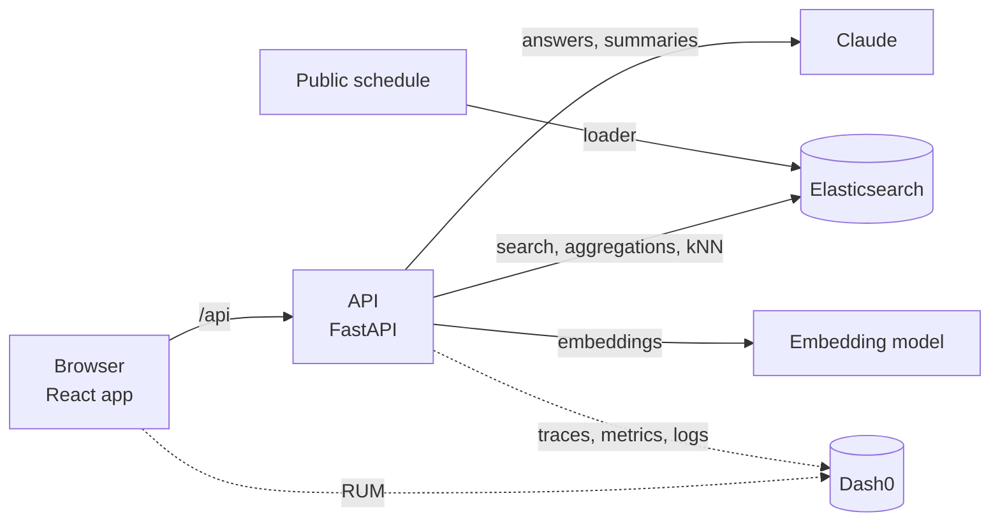
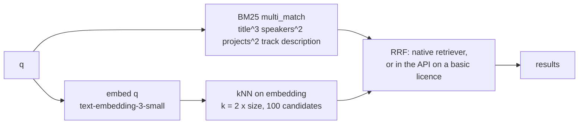
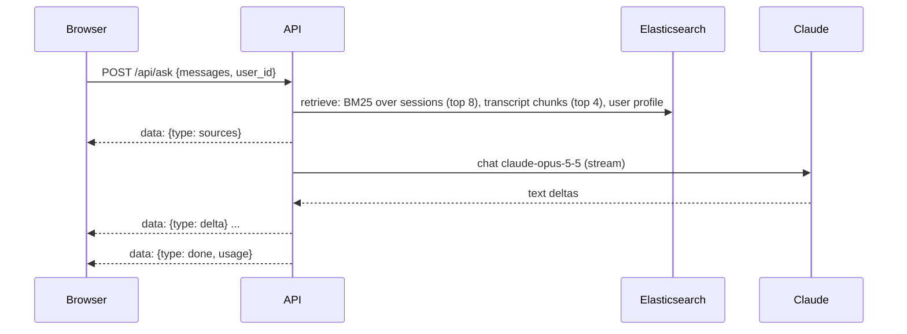

# Architecture

Concept only for now. Each section is filled in by the pull request that builds it.

## Components

| Component | Role | Detailed in |
|---|---|---|
| Browser app | Pages, navigation, browser telemetry | Pull request 2b |
| API | One service; every endpoint traced | Pull requests 0, 1 |
| Elasticsearch | Sessions, people, agendas, transcripts, connections | Pull requests 2, 3 |
| LLM | Ask and Catch up answers, grounded in retrieved documents | Pull requests 8, 9 |
| Telemetry | OpenTelemetry to Dash0: traces, metrics, logs, RUM | Pull requests 1, 12 |

## Data (pull request 2)

`uv run python -m app.load` reads the snapshot in `data/raw/` and fills three indices. `--only sessions|people|agenda` rebuilds one index and leaves the others alone.

| Index | Holds | Count |
|---|---|---|
| `confox-sessions` | Every scheduled session: time (local, no offset), day, room, venue, track, level, CNCF projects, speakers, kind, `is_food` | 600 |
| `confox-people` | 712 public speaker profiles from the schedule, plus 80 generated attendees marked `sample: true` (Emma and Alice first, then University of Utah alumni) | 792 |
| `confox-agenda` | Emma's Monday: the co-located AI day, a confirmed coffee with Alice, a pending lunch request (all `sample: true`) | 3 |

Session kinds come from the track and the cleaned title: `keynote`, `talk`, `lightning`, `tutorial`, `contribfest`, `poster`, `showcase`, `colocated`, `break`, `registration`. Titles are stripped of emoji first, so "☕ Coffee Break" inside the Project Lightning Talks track is a `break` with `is_food`.

Planned: vectors on sessions and people (pull request 3), connections (pull request 7). Transcripts: see Catch up (pull request 9).
With `OPENAI_API_KEY` set, sessions and people also carry an `embedding` (see Search). Planned: transcripts (pull request 9), connections (pull request 7).

## Search (pull request 3)

`GET /api/search` finds sessions. Params: `q`, `day`, `kind`, `track`, `level` (each repeatable, for example `kind=talk&kind=keynote`), `upcoming` (only sessions ending after `clock.now()`), `mode` (`hybrid` default or `bm25`), `size` (default 20, clamped to 50).

- **Hybrid, native (`"mode": "hybrid"`).** One Elasticsearch request with the `rrf` retriever: a `standard` retriever (the BM25 query) and a `knn` retriever (the query vector), fused by reciprocal rank fusion (rank constant 60, rank window 50). RRF uses ranks, not scores, so BM25 and cosine scores never need normalising. The same filters go into both retrievers; on the kNN side they are pre-filters, so `k` neighbours survive the filters.
- **Hybrid, client-side (`"mode": "hybrid-client"`).** The `rrf` retriever needs an Enterprise or trial licence. On a basic licence Elasticsearch rejects it with a security exception naming RRF; the API then fetches the BM25 top 50 and the kNN neighbours as two bodies of one `msearch` and fuses them in Python with the same formula (`rrf_fuse`: each list adds 1 / (60 + rank) per document). The fallback is logged and recorded on the span (exception plus a `confox.search.rrf_fallback` event), and the process remembers it, so later requests skip the failing native call. Other Elasticsearch errors are raised, not hidden. On the demo data both paths return the same ranking and scores; `total` is approximate on the client path (BM25 matches, or the fused union if larger).
- **Keyword.** `mode=bm25`, and the automatic fallback when there is no `OPENAI_API_KEY`, no `q`, or the query embedding fails (logged and recorded on the span, response says `"mode": "bm25"`).
- **No `q`.** Sessions matching the filters in `starts_at` order; `score` is null.
- **Facets.** `day`, `kind`, `track`, `level` counts come from a second body in the same `msearch` call. Each facet is counted over the matches with every filter except its own, so choosing Tuesday still shows the other days. In hybrid mode the match set is BM25 matches plus kNN neighbours, which approximates the fused list.
- **Results** never include `embedding`, and `description` is cut to 400 characters. `took_ms` is the whole handler, query embedding included (warm: about 10 ms keyword, 0.5 s hybrid, almost all of it the embedding call).
- **Vectors.** `embedding` is a 1536-dimension `dense_vector` (cosine) on sessions (title, track, projects, description) and people (name, title, company, interests, bio), trimmed to 2000 characters and computed by the loader in batches of 100. Elasticsearch 9 leaves dense vectors out of `_source`, so `app.embeddings.get_vector` reads one with `source_exclude_vectors=False`; plain `_source` reads never see it.
- **Telemetry.** Each embedding batch is an `embed` span (model, count, tokens, cost); metrics `confox.embeddings.tokens`, `confox.embeddings.cost` (USD), `confox.search.duration` (ms) and `confox.search.requests`, by `mode`.
- **Licence.** `compose.yaml` starts Elasticsearch with `xpack.license.self_generated.type=trial` so native RRF works for 30 days on a fresh stack; after that, or on any basic-licence cluster, search keeps working through client-side RRF.

## People and Match (pull request 6)

`GET /api/people/match` ranks everyone else for the signed-in user (`settings.demo_user`); `GET /api/people/{id}` returns one profile. Both live in `backend/app/routers/people.py`; the page is `src/pages/People.tsx` with `src/components/people/`.

| Shared with the user | Boost | Reason shown |
|---|---|---|
| School | 6 per school | "University of Utah alumni" |
| Current or past company (any overlap) | 3 | "Works at ..." / "Worked at ..." |
| Community | 2 each | "Both in ..." |
| City | 2 | "Also in ..." |
| Interest | 1.5 each | "Both into ..." |
| User's interests as text in a speaker's tracks or bio | BM25 x 0.5 | "Speaks on ..." / "Mentions ..." |

- **One query.** A `bool` of `constant_score` clauses, one per shared value, so each overlap adds a fixed, explainable amount; `minimum_should_match: 0` keeps people with nothing in common at the bottom rather than hiding them. A keyword `q` becomes a `multi_match` must clause on name, title, company, interests and bio. `kind` (Attendees or Speakers tab) is a query filter.
- **Vectors when present.** If the user's profile has an `embedding`, the query is wrapped in `script_score` adding `4 x max(0, cosine)`. A weighted sum, not RRF: the boosts stay in charge (one shared school outweighs any embedding), scores stay readable, and aggregations and `post_filter` keep working on one plain query. If vector scoring fails (field missing mid-rebuild) the request logs a warning, records it on the span and ranks lexically; `semantic` in the response says which happened.
- **Reasons in Python.** `why` is computed from the same overlap the query boosts, at most three, schools first, so every reason is true and clickable. Each reason names its field; clicking it applies that exact filter (`school`, `company`, `community`, `city`, `interest`) or, for a bio mention, a keyword search.
- **Group chips.** `filters` aggregations restricted to the user's own schools, companies, communities, city and country count the other people sharing each. Background filters go in `post_filter`, so chip counts stay stable while chips are toggled.
- **Telemetry.** Requests count on `confox.match.requests` (attributes `kind`, `has_query`, `filtered`); the request span carries `confox.match.semantic`.
- Attendees are generated samples and every card says "Sample"; speakers are public schedule profiles.

## Telemetry (pull request 1)

| Signal | Source | Where it goes |
|---|---|---|
| Traces | FastAPI instrumentation for every request; the Elasticsearch 9 client traces its own calls as child spans | Dash0 via OTLP/HTTP |
| Logs | Python logging, exported with the active trace and span IDs | Dash0 via OTLP/HTTP |
| Metrics | HTTP server metrics from the instrumentation; product metrics added with each feature | Dash0 via OTLP/HTTP |
| Browser | Dash0 web SDK: page views, web vitals, fetch calls, errors; adds the trace header to same-origin `/api` calls | Dash0, ingest-only token |

Export switches on only when `OTEL_EXPORTER_OTLP_ENDPOINT` is set. A demo-only endpoint (`POST /api/debug/break`, off by default) sends Elasticsearch a query it rejects, so Dash0 has a real error to find.

## Dashboard (pull request 5)

"The conference pulse" for one day, built only from Elasticsearch aggregations. `GET /api/dashboard?day=YYYY-MM-DD` (default: the day of `clock.now()`) makes two `size: 0` searches; the response shape is documented in `backend/app/routers/dashboard.py`.

| Request | Aggregations | Feeds |
|---|---|---|
| `confox-sessions` | `cardinality` of `speaker_ids` and `track` (week); `terms` on `day` (day selector); a `filter` on the day holding `cardinality` (speakers, tracks), `terms` on `track` (top 10) and `kind`, a `date_histogram` on `starts_at` (30 minutes, 07:00 to 19:00, empty buckets kept) with `terms` on `kind` per bucket, and a `filter` on the next 90 minutes (registration left out) with `top_hits` | Stat tiles, timeline, starting soon, top tracks |
| `confox-people` | `filter` on `sample: true` with `terms` and `cardinality` on `country`; `filter` on `kind: speaker` with `terms` on `company` | Attendee count and countries, speaker companies |

Kinds fold into five groups for the timeline (talks, keynotes, co-located, breaks and food, other); the folding lives in Python so it is unit tested against hand-written aggregation responses. The page draws the stacked bars in plain SVG with a now line, hover and keyboard readouts, and a visually hidden table of every value. Chart colours are the `--chart-*` tokens in `index.css`, five categorical slots validated for colour-vision deficiency against the panel colour. Attendee numbers are labelled as sample data.

## How features plug in

| Piece | Where | Rule |
|---|---|---|
| API routes | `backend/app/routers/<feature>.py` defining `router = APIRouter(prefix="/api/<feature>")` | Discovered automatically; never edit `main.py` to add a feature |
| Current time | `app.clock.now()` | Demo moment (`DEMO_NOW`, Monday 8:40) or real Salt Lake City time; naive, like the schedule |
| Signed-in user | `settings.demo_user` / `GET /api/meta` | `emma` in the demo |
| Frontend calls | `getJSON` / `postJSON` from `src/api.ts` | Same-origin `/api`, so browser and API spans join one trace |
| Feature UI | `src/pages/<Page>.tsx` plus `src/components/<feature>/` and `src/styles/<feature>.css` | Keeps parallel features out of each other's files |

## Ask (pull request 8)

`POST /api/ask` answers a question from retrieved sessions and streams the answer as Server-Sent Events.

| Piece | Where | Notes |
|---|---|---|
| Retrieval | `routers/ask.py`, span `retrieve` | `multi_match` over title^3, speaker_names^2, projects^2, track, description; breaks and registration excluded. A day named in the question ("today", "tomorrow", "Wednesday") filters to that day; otherwise today gets a small boost |
| Prompt | system: role, `clock.now()` spoken ("Monday 9 November, 08:40"), the user's interests and school; latest user turn: numbered sources then the question | Earlier turns are sent back as plain text |
| Answer | Claude cites `[n]`; the browser shows chips only for the sources the answer cites, with day, time and room | Says so when the sources do not answer |
| Events | `sources`, `delta`, `done` (tokens, cost, duration, stop reason) or `error` | Counter `confox.chat.requests` (attribute `feature`) |

### LLM calls (`app/llm.py`)

Every Claude call goes through `llm.complete` (blocking, streamed under the hood) or `llm.stream` (async generator for Server-Sent Events). Model from `settings.llm_model` (`claude-opus-5-5`), official `anthropic` Python SDK, effort `low`, server-side refusal fallback (`fallbacks: "default"`).

| Signal | Name | Content |
|---|---|---|
| Span | `chat {model}` (kind client) | `gen_ai.operation.name`, `gen_ai.provider.name` = anthropic, `gen_ai.request.model`, `gen_ai.request.max_tokens`, `gen_ai.response.model`, `gen_ai.response.id`, `gen_ai.response.finish_reasons`, `gen_ai.usage.input_tokens`, `gen_ai.usage.output_tokens`, cache token counts when present, `confox.llm.cost_usd`, `confox.llm.feature` |
| Child span | `anthropic.messages.create` | Emitted by the Anthropic SDK itself (metadata only, no prompt content) |
| Counter | `confox.llm.tokens` | Attributes `type` (input, output, cache_read, cache_write), `model`, `feature` |
| Counter | `confox.llm.cost_usd` | Estimated from the price table in `llm.py` (Opus 5.5: $4 input, $20 output per million tokens) |
| Histogram | `confox.llm.duration` | Milliseconds, per `model` and `feature` |

Streaming calls record usage from the final message when the stream ends. Failures are recorded on the span and logged; the browser receives an `error` event.

## Catch up (pull request 9)

Catch up turns a missed keynote into something readable: a TL;DR, three takeaways, the transcript, and questions answered from that transcript only.

| Piece | Where | Notes |
|---|---|---|
| Sample transcripts | `data/sample/transcripts.json`, written once by `uv run python -m app.data.transcripts --generate` | Three Tuesday 10 November keynotes, about 1300 words each, written by Claude from each keynote's public title, speakers and description only; `sample: true` |
| Index | `confox-transcripts`, loaded by `uv run python -m app.data.transcripts --load` | ~200-word chunks (`doc_type: chunk`, `session_id`, `chunk`, `text`, `sample`); rebuilding it touches no other index and never calls Claude |
| `GET /api/catchup` | `routers/catchup.py` | Talks that have a transcript, with time, room and speakers |
| `GET /api/catchup/{id}` | | Transcript parts and `{tldr, takeaways}`. The summary is generated with Claude (structured JSON output) on the first request and stored in the same index as `summary-{id}` (`doc_type: summary`), so later requests are instant |
| `POST /api/catchup/{id}/ask` | | Server-Sent Events like Ask; every part of that one transcript goes in the prompt and the answer cites part numbers. The browser's chips open the transcript at the cited part |

The UI labels every transcript "Sample transcript (generated)"; on a talk page the label stays pinned while reading. Reading comfort is the point of the feature: larger type, 1.6 to 1.75 line height, lines capped near 65 characters, the transcript collapsed until wanted.
## Schedule (pull request 4)

`GET /api/schedule/day?day=YYYY-MM-DD&user_id=emma` returns one day of sessions (registration left out, sorted by start, descriptions cut to 300 characters) with the user's agenda, and marks each session `for_you`, `why` (at most two reasons), `fit` (0 to 1), `on_agenda` and `clashes`. `GET /api/schedule/days` is a `terms` aggregation on `day` for the day tabs.

| Rule | Reason shown |
|---|---|
| On the user's agenda | "on your agenda" |
| Keynote, or a food break | "keynote", "food and coffee" |
| An interest or project phrase in the title, projects, track or description (case-insensitive, whole words); the place sets the fit | "matches AI inference" |
| Among the day's 12 nearest sessions to the profile vector (kNN on `embedding`, filtered to the day), when both have vectors | "close to your interests" |

For you stays short because you can only be in one room: agenda items, keynotes and food always stay; among other picks that start at the same time, the best one stays, plus a second only when its fit is 0.75 or more (a title or project match). The rest keep their reasons and show in Everything. Without vectors, the rules alone decide and `semantic` is false.

Clashes list confirmed agenda items that overlap a session. A full-day co-located event on the agenda is left out, or every session that day would clash; breaks and co-located sessions never show clashes (a meeting over coffee happens at the break). Pending requests never clash.

The page (`src/pages/Schedule.tsx`, `src/components/schedule/`) has day tabs from Monday, a debounced search box over `GET /api/search` (results replace the day view and show the search mode and time; if search is missing it says so and keeps the day view), a For you / Everything toggle with a count, time blocks where runs of other sessions fold into "N more sessions", meetings and pending requests in their slot, and a "now" line from `/api/meta`. Times are read from the strings, never converted through the browser's time zone.

## Agenda and Meet (pull request 7 and 11)

Personal items live in `confox-agenda`, one document each; the shape and the pure rules are in `backend/app/agenda_store.py`, shared by `routers/agenda.py` and `routers/connect.py`. My brief reads the same documents.

| Field | Meaning |
|---|---|
| `kind`, `status` | `session` or `meeting`; `confirmed`, `pending` or `declined` |
| `direction` | Meetings only: `incoming` or `outgoing`. A pending meeting without one is incoming (the seeded lunch request) |
| `session_id` | Sessions: the session. Meetings: the food or coffee break used as the slot (absent on seeded meetings) |
| `with_id`, `with_name`, `message` | Meetings: the other person and the optional line (at most 200 characters) |
| `title`, `starts_at`, `ends_at`, `room` | Copied from the session or break when the item is written, so reads need no join |
| `sample`, `created_at` | `true` only for seeded items; local time of the write |

Ids: `{user}-s-{session_id}` for added sessions, `{user}-m-{8 hex}` for new requests; seeded items keep theirs.

| Endpoint | Returns |
|---|---|
| `GET /api/agenda?user_id&day` | `{items: confirmed sessions and meetings by start, pending: pending meetings}` |
| `POST /api/agenda {user_id, session_id}` | The session item. Idempotent (an existing entry, seeded ones included, is returned); breaks and registration are refused (422) |
| `DELETE /api/agenda/{session_id}?user_id` | `{session_id, deleted}`; removes every session entry of the user for it by query, 404 if none |
| `GET /api/connect/slots?user_id&with_id` | `{slots: [{session_id, title, starts_at, ends_at, room, day}]}`, at most 3 |
| `POST /api/connect {user_id, with_id, session_id, message}` | The new pending outgoing meeting; 409 when a pending or confirmed meeting with that person overlaps the slot |
| `GET /api/connect?user_id` | `{incoming, outgoing, meetings}`: pending to the user, pending from the user, confirmed |
| `POST /api/connect/{id}/accept`, `/decline` | The item with status `confirmed` or `declined`; only for a pending incoming request (409 otherwise, 404 if not the user's) |

- **Free slots.** Food and coffee breaks (`is_food`) from `clock.now()` on, today first, then the next day that has breaks. A break is taken when it overlaps a confirmed item of the user (a co-located full day is ignored, as in Schedule) or a pending or confirmed meeting with the same person. Pending requests with other people do not block. The meeting title comes from the break ("Lunch \| On Own" becomes "Lunch").
- **Writes.** Every write refreshes the agenda index so the next read sees it. Counters: `confox.agenda.changes` (attribute `action`: add, remove) and `confox.connect.requests` (`action`: send, accept, decline); the request spans carry the session or person id.
- **Schedule.** Each day-view row except breaks and registration has an "Agenda" / "Added" toggle; it writes, then reloads the day and the agenda ids, so For you, clashes and the count update together. Search results get the same toggle through the `SessionCard` aside, with state from `GET /api/agenda`. Outgoing requests show as "Request sent".
- **People.** Every card has a primary "Meet" button that opens an inline panel: the free slots as a native radio group (first one chosen and focused), an optional line, "Send request". After sending, the card says "Request sent for 14:48 · Coffee" and the button becomes a disabled "Requested" (warn colours, since it is pending); people with a pending outgoing request show "Requested" on load, and a confirmed meeting shows as a green chip. Escape closes the panel and returns focus to the button.
## My brief (pull request 10)

One calm page for the signed-in attendee's day. `GET /api/brief?user_id=emma` (day of `clock.now()`) lives in `backend/app/routers/brief.py`; the page is `src/pages/Brief.tsx` with `src/components/brief/` and `src/styles/brief.css`. Nothing new is stored: the endpoint reads `confox-sessions`, `confox-people` and `confox-agenda` and reuses the other features' helpers (schedule `_day_sessions`, `annotate`, `_knn`; Match `build_match_query`, `why`; `next_food()`).

| Part | Rule |
|---|---|
| `timeline` | Today's confirmed agenda sessions and meetings plus the day's food breaks, by start. A break that starts with a confirmed meeting is left out (the coffee with Alice is that break). Co-located sessions carry `all_day` and a short title ("Cloud Native AI + Inference Day"; `full_title` keeps the original) |
| `is_next` | The first item not yet ended; a co-located day already under way is skipped while something else is still to come, so the marker moves to the coffee, then lunch |
| `gaps` | Free windows of 60+ minutes between 08:00 and 19:00, from now on; all-day co-located events do not block (they would hide every gap) |
| `requests` | Pending meetings today split into `incoming` (no direction counts as incoming) and `outgoing`; a request without a room takes the room of the food break at the same time |
| `people` | The Match ranking (same query, vector when present, lexical fallback logged on the span), minus anyone the user already has a meeting, request or declined request with today; up to 3, each with the first `why` reason and `free_at`: the first food break after now that does not overlap the user's confirmed plans |
| `suggested` | Up to 3 for-you sessions (interest phrase or kNN) not on the agenda, not started, not clashing; other co-located days and breaks left out |
| `summary` | Plain sentences from the data, no LLM: the anchor event, confirmed meetings, waiting requests |

The page shows the date and summary, "People today" (confirmed meetings, incoming requests with Accept and Decline, suggested people linking to `/people?q=`), the "Your day" timeline (dashed free rows link to `/schedule`) and "Suggested for you" as `SessionCard`s. Accept and Decline call `POST /api/connect/{id}/accept|decline` from the connect pull request and refresh; on a 404 the card says "Not available yet". The request span carries `confox.brief.timeline`, `confox.brief.requests_incoming`, `confox.brief.people` and `confox.brief.suggested`. Agenda items and people are labelled as generated sample data.

## Key decisions

| Decision | Why |
|---|---|
| Claude answers stream as Server-Sent Events over a POST | The browser reads the same-origin `fetch` body, so the trace header still joins browser and API spans; `EventSource` cannot send a body |
| Sample transcripts generated once and committed | Loading is free and repeatable; nobody pays for or waits on Claude at load time |
| Load `.env` into the process environment at startup | The OTLP exporters read `OTEL_*` from the environment, not from app settings |
| No separate Elasticsearch instrumentor | The Elasticsearch 9 Python client has native OpenTelemetry support; the contrib instrumentor disables itself |
| One `.env` at the repo root for both halves | Only `VITE_*` values reach the browser bundle; everything else stays server side |
| Explicit mappings, one index rebuilt at a time | Dates and keywords behave predictably in filters and aggregations; reloading sessions never wipes people or agendas |
| Times stored as local conference time | The source has no offset and every attendee reads the schedule in Salt Lake City time |
| Hybrid search fused with Elasticsearch's `rrf` retriever | One request, rank-based fusion needs no score tuning, and filters apply to both sides |
| Client-side RRF when the licence refuses native RRF | A fresh stack on a basic licence must not fail search; the same formula in Python gives the same ranking |
| Embeddings computed by the loader, not at ingest in Elasticsearch | Keeps the model call visible in our traces with tokens and cost, and search works keyword only without a key |
| ASGI `send`/`receive` spans excluded | One server span per request keeps traces readable; Elasticsearch calls still appear as child spans |
