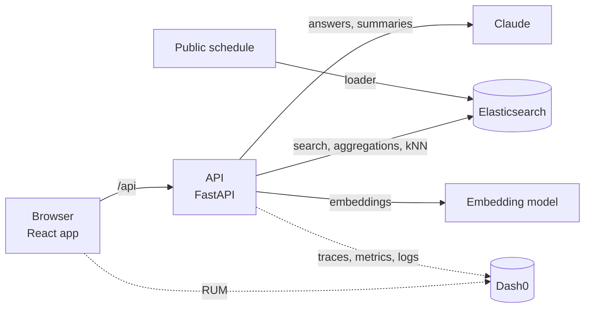
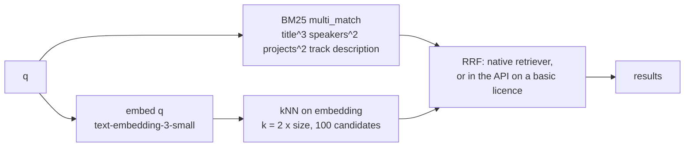

# Architecture

Concept only for now. Each section is filled in by the pull request that builds it.

## Components

| Component | Role | Detailed in |
|---|---|---|
| Browser app | Pages, navigation, browser telemetry | Pull request 2b |
| API | One service; every endpoint traced | Pull requests 0, 1 |
| Elasticsearch | Sessions, people, agendas, transcripts, connections | Pull requests 2, 3 |
| LLM | Ask and Catch up answers, grounded in retrieved documents | Pull requests 8, 9 |
| Telemetry | OpenTelemetry to Dash0: traces, metrics, logs, RUM | Pull requests 1, 12 |

## Data (pull request 2)

`uv run python -m app.load` reads the snapshot in `data/raw/` and fills three indices. `--only sessions|people|agenda` rebuilds one index and leaves the others alone.

| Index | Holds | Count |
|---|---|---|
| `confox-sessions` | Every scheduled session: time (local, no offset), day, room, venue, track, level, CNCF projects, speakers, kind, `is_food` | 600 |
| `confox-people` | 712 public speaker profiles from the schedule, plus 80 generated attendees marked `sample: true` (Emma and Alice first, then University of Utah alumni) | 792 |
| `confox-agenda` | Emma's Monday: the co-located AI day, a confirmed coffee with Alice, a pending lunch request (all `sample: true`) | 3 |

Session kinds come from the track and the cleaned title: `keynote`, `talk`, `lightning`, `tutorial`, `contribfest`, `poster`, `showcase`, `colocated`, `break`, `registration`. Titles are stripped of emoji first, so "☕ Coffee Break" inside the Project Lightning Talks track is a `break` with `is_food`.

With `OPENAI_API_KEY` set, sessions and people also carry an `embedding` (see Search). Planned: transcripts (pull request 9), connections (pull request 7).

## Search (pull request 3)

`GET /api/search` finds sessions. Params: `q`, `day`, `kind`, `track`, `level` (each repeatable, for example `kind=talk&kind=keynote`), `upcoming` (only sessions ending after `clock.now()`), `mode` (`hybrid` default or `bm25`), `size` (default 20, clamped to 50).

- **Hybrid, native (`"mode": "hybrid"`).** One Elasticsearch request with the `rrf` retriever: a `standard` retriever (the BM25 query) and a `knn` retriever (the query vector), fused by reciprocal rank fusion (rank constant 60, rank window 50). RRF uses ranks, not scores, so BM25 and cosine scores never need normalising. The same filters go into both retrievers; on the kNN side they are pre-filters, so `k` neighbours survive the filters.
- **Hybrid, client-side (`"mode": "hybrid-client"`).** The `rrf` retriever needs an Enterprise or trial licence. On a basic licence Elasticsearch rejects it with a security exception naming RRF; the API then fetches the BM25 top 50 and the kNN neighbours as two bodies of one `msearch` and fuses them in Python with the same formula (`rrf_fuse`: each list adds 1 / (60 + rank) per document). The fallback is logged and recorded on the span (exception plus a `confox.search.rrf_fallback` event), and the process remembers it, so later requests skip the failing native call. Other Elasticsearch errors are raised, not hidden. On the demo data both paths return the same ranking and scores; `total` is approximate on the client path (BM25 matches, or the fused union if larger).
- **Keyword.** `mode=bm25`, and the automatic fallback when there is no `OPENAI_API_KEY`, no `q`, or the query embedding fails (logged and recorded on the span, response says `"mode": "bm25"`).
- **No `q`.** Sessions matching the filters in `starts_at` order; `score` is null.
- **Facets.** `day`, `kind`, `track`, `level` counts come from a second body in the same `msearch` call. Each facet is counted over the matches with every filter except its own, so choosing Tuesday still shows the other days. In hybrid mode the match set is BM25 matches plus kNN neighbours, which approximates the fused list.
- **Results** never include `embedding`, and `description` is cut to 400 characters. `took_ms` is the whole handler, query embedding included (warm: about 10 ms keyword, 0.5 s hybrid, almost all of it the embedding call).
- **Vectors.** `embedding` is a 1536-dimension `dense_vector` (cosine) on sessions (title, track, projects, description) and people (name, title, company, interests, bio), trimmed to 2000 characters and computed by the loader in batches of 100. Elasticsearch 9 leaves dense vectors out of `_source`, so `app.embeddings.get_vector` reads one with `source_exclude_vectors=False`; plain `_source` reads never see it.
- **Telemetry.** Each embedding batch is an `embed` span (model, count, tokens, cost); metrics `confox.embeddings.tokens`, `confox.embeddings.cost` (USD), `confox.search.duration` (ms) and `confox.search.requests`, by `mode`.
- **Licence.** `compose.yaml` starts Elasticsearch with `xpack.license.self_generated.type=trial` so native RRF works for 30 days on a fresh stack; after that, or on any basic-licence cluster, search keeps working through client-side RRF.

## Telemetry (pull request 1)

| Signal | Source | Where it goes |
|---|---|---|
| Traces | FastAPI instrumentation for every request; the Elasticsearch 9 client traces its own calls as child spans | Dash0 via OTLP/HTTP |
| Logs | Python logging, exported with the active trace and span IDs | Dash0 via OTLP/HTTP |
| Metrics | HTTP server metrics from the instrumentation; product metrics added with each feature | Dash0 via OTLP/HTTP |
| Browser | Dash0 web SDK: page views, web vitals, fetch calls, errors; adds the trace header to same-origin `/api` calls | Dash0, ingest-only token |

Export switches on only when `OTEL_EXPORTER_OTLP_ENDPOINT` is set. A demo-only endpoint (`POST /api/debug/break`, off by default) sends Elasticsearch a query it rejects, so Dash0 has a real error to find.

## Dashboard (pull request 5)

"The conference pulse" for one day, built only from Elasticsearch aggregations. `GET /api/dashboard?day=YYYY-MM-DD` (default: the day of `clock.now()`) makes two `size: 0` searches; the response shape is documented in `backend/app/routers/dashboard.py`.

| Request | Aggregations | Feeds |
|---|---|---|
| `confox-sessions` | `cardinality` of `speaker_ids` and `track` (week); `terms` on `day` (day selector); a `filter` on the day holding `cardinality` (speakers, tracks), `terms` on `track` (top 10) and `kind`, a `date_histogram` on `starts_at` (30 minutes, 07:00 to 19:00, empty buckets kept) with `terms` on `kind` per bucket, and a `filter` on the next 90 minutes (registration left out) with `top_hits` | Stat tiles, timeline, starting soon, top tracks |
| `confox-people` | `filter` on `sample: true` with `terms` and `cardinality` on `country`; `filter` on `kind: speaker` with `terms` on `company` | Attendee count and countries, speaker companies |

Kinds fold into five groups for the timeline (talks, keynotes, co-located, breaks and food, other); the folding lives in Python so it is unit tested against hand-written aggregation responses. The page draws the stacked bars in plain SVG with a now line, hover and keyboard readouts, and a visually hidden table of every value. Chart colours are the `--chart-*` tokens in `index.css`, five categorical slots validated for colour-vision deficiency against the panel colour. Attendee numbers are labelled as sample data.

## How features plug in

| Piece | Where | Rule |
|---|---|---|
| API routes | `backend/app/routers/<feature>.py` defining `router = APIRouter(prefix="/api/<feature>")` | Discovered automatically; never edit `main.py` to add a feature |
| Current time | `app.clock.now()` | Demo moment (`DEMO_NOW`, Monday 8:40) or real Salt Lake City time; naive, like the schedule |
| Signed-in user | `settings.demo_user` / `GET /api/meta` | `emma` in the demo |
| Frontend calls | `getJSON` / `postJSON` from `src/api.ts` | Same-origin `/api`, so browser and API spans join one trace |
| Feature UI | `src/pages/<Page>.tsx` plus `src/components/<feature>/` and `src/styles/<feature>.css` | Keeps parallel features out of each other's files |

## Schedule (pull request 4)

`GET /api/schedule/day?day=YYYY-MM-DD&user_id=emma` returns one day of sessions (registration left out, sorted by start, descriptions cut to 300 characters) with the user's agenda, and marks each session `for_you`, `why` (at most two reasons), `fit` (0 to 1), `on_agenda` and `clashes`. `GET /api/schedule/days` is a `terms` aggregation on `day` for the day tabs.

| Rule | Reason shown |
|---|---|
| On the user's agenda | "on your agenda" |
| Keynote, or a food break | "keynote", "food and coffee" |
| An interest or project phrase in the title, projects, track or description (case-insensitive, whole words); the place sets the fit | "matches AI inference" |
| Among the day's 12 nearest sessions to the profile vector (kNN on `embedding`, filtered to the day), when both have vectors | "close to your interests" |

For you stays short because you can only be in one room: agenda items, keynotes and food always stay; among other picks that start at the same time, the best one stays, plus a second only when its fit is 0.75 or more (a title or project match). The rest keep their reasons and show in Everything. Without vectors, the rules alone decide and `semantic` is false.

Clashes list confirmed agenda items that overlap a session. A full-day co-located event on the agenda is left out, or every session that day would clash; breaks and co-located sessions never show clashes (a meeting over coffee happens at the break). Pending requests never clash.

The page (`src/pages/Schedule.tsx`, `src/components/schedule/`) has day tabs from Monday, a debounced search box over `GET /api/search` (results replace the day view and show the search mode and time; if search is missing it says so and keeps the day view), a For you / Everything toggle with a count, time blocks where runs of other sessions fold into "N more sessions", meetings and pending requests in their slot, and a "now" line from `/api/meta`. Times are read from the strings, never converted through the browser's time zone.

## Key decisions

| Decision | Why |
|---|---|
| Load `.env` into the process environment at startup | The OTLP exporters read `OTEL_*` from the environment, not from app settings |
| No separate Elasticsearch instrumentor | The Elasticsearch 9 Python client has native OpenTelemetry support; the contrib instrumentor disables itself |
| One `.env` at the repo root for both halves | Only `VITE_*` values reach the browser bundle; everything else stays server side |
| Explicit mappings, one index rebuilt at a time | Dates and keywords behave predictably in filters and aggregations; reloading sessions never wipes people or agendas |
| Times stored as local conference time | The source has no offset and every attendee reads the schedule in Salt Lake City time |
| Hybrid search fused with Elasticsearch's `rrf` retriever | One request, rank-based fusion needs no score tuning, and filters apply to both sides |
| Client-side RRF when the licence refuses native RRF | A fresh stack on a basic licence must not fail search; the same formula in Python gives the same ranking |
| Embeddings computed by the loader, not at ingest in Elasticsearch | Keeps the model call visible in our traces with tokens and cost, and search works keyword only without a key |
| ASGI `send`/`receive` spans excluded | One server span per request keeps traces readable; Elasticsearch calls still appear as child spans |
